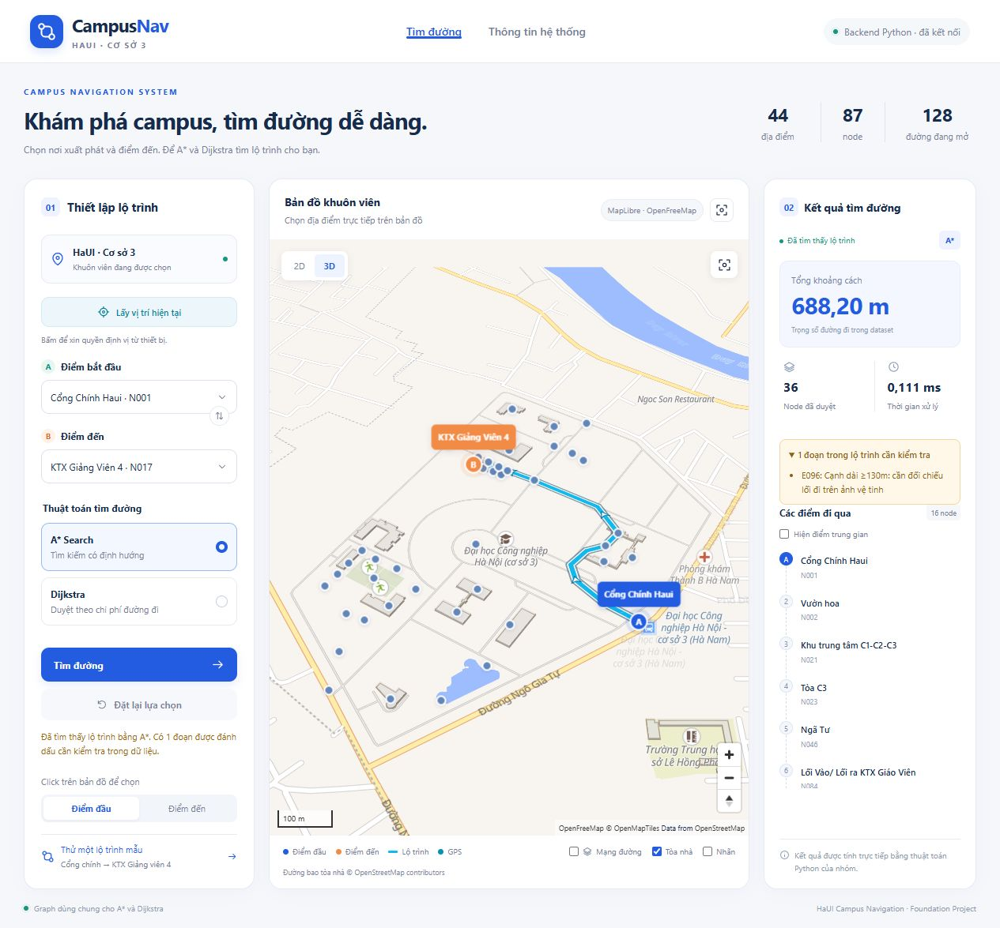

# Shortest Path Finding in a Campus Navigation System

Website tìm đường trong khuôn viên HaUI cơ sở 3, kết nối trực tiếp thuật toán
**A\*** và **Dijkstra** viết bằng Python. Giao diện tiếng Việt, bản đồ
**MapLibre + OpenFreeMap** 



## Chạy ứng dụng

Yêu cầu Python 3.10+ và trình duyệt hiện đại. Backend dùng thư viện chuẩn của
Python; không cần cài thêm package. Các thư viện bản đồ được lưu trong `vendor/`.

```bash
git clone https://github.com/Daiijin/Shortest-Path-Finding-in-a-Campus-Navigation-System.git
cd Shortest-Path-Finding-in-a-Campus-Navigation-System
python web_server.py
```

Mở **http://127.0.0.1:8765/**. Trên Windows có thể nhấp đúp `run_website.cmd`.
Đổi cổng bằng `python web_server.py --port 8766`; dừng server bằng Ctrl+C.
Chạy qua server Python để giao diện gọi được API thuật toán.

## Tính năng

- Tìm kiếm 44 địa điểm theo tên, từ khóa không dấu hoặc ID; chọn bằng marker.
- Đảo điểm đầu/điểm đến; chọn A* hoặc Dijkstra; tìm đường và đặt lại.
- Graph gồm 87 node và 134 cạnh. Đường đi giữ toàn bộ các waypoint trung gian.
- Hiển thị khoảng cách, số node đã duyệt, thời gian thuật toán và các điểm đi qua.
- Bản đồ 2D/3D, phóng to/thu nhỏ, mở rộng, bật/tắt lớp tòa nhà và mạng đường.
- Tuyến đường xanh có viền trắng và mũi tên chỉ hướng.
- GPS theo thao tác người dùng, vòng sai số và gợi ý điểm đầu gần nhất.
- Nền campus local với đường, hồ, sân thể thao và 23 đường bao tòa nhà từ OSM.
- Leaflet và sơ đồ tọa độ dự phòng khi trình duyệt không hỗ trợ WebGL.
- Giao diện responsive trên máy tính, tablet và điện thoại.

Chế độ 3D dựng khối tòa nhà theo dữ liệu bản đồ. Khi bản campus local thiếu
chiều cao, khối minh họa dùng 8 m. Route dựa vào dữ liệu graph của nhóm, cần
được đối chiếu với các lối đi thực địa. GPS gợi ý một location; khoảng cách
chưa gồm đoạn từ vị trí thiết bị đến node được chọn.

## Cấu trúc

| Thành phần | Vai trò |
|---|---|
| `index.html`, `css/style.css` | Bố cục, thiết kế và responsive |
| `js/main.js`, `js/api.js` | Tương tác, trạng thái và gọi API |
| `js/open_map.js`, `js/map.js` | MapLibre, bản đồ dự phòng, marker và route |
| `js/location.js` | Browser Geolocation và gợi ý location |
| `web_server.py` | Phục vụ website và API HTTP/JSON |
| `haui_astar_project/` | Thuật toán Python, graph loader, CSV và route service |
| `data/campus3/*.geojson` | Đường bao tòa nhà và nền campus local |
| `vendor/` | Thư viện bản đồ và giấy phép tương ứng |

```text
Trình duyệt → POST /api/route → route_service.find_route()
             → A* / Dijkstra → JSON path_coordinates → vẽ tuyến + kết quả
```

API dữ liệu: `GET /api/health`, `/api/graph`, `/api/config`, `/api/buildings`,
`/api/basemap`. Tìm đường: `POST /api/route` với JSON
`{"start":"N001","goal":"N017","algorithm":"astar"}`.

## Kiểm thử

```bash
python -m unittest test_web -v
```

Để kiểm thử logic GPS, dùng Node.js 20+:

```bash
npm test
```

## Cấu hình và nguồn dữ liệu

- [Hướng dẫn bản đồ miễn phí](FREE_MAP_SETUP.md)
- [Chi tiết website và API](README_WEBSITE.md)
- [Leaflet dự phòng](LEAFLET_SETUP.md)
- [Google Maps tùy chọn](GOOGLE_MAPS_SETUP.md)

Không cần cấu hình key cho bản mặc định. Nếu dùng Google Maps, sao chép
`maps_config.example.json` thành `maps_config.local.json`, chọn provider
`google` và cấu hình key có giới hạn. File local được Git bỏ qua và không
được phục vụ trực tiếp qua HTTP. Google Maps có yêu cầu Billing riêng.

GPS cần quyền Location và HTTPS khi triển khai; localhost trên cùng thiết bị
có thể dùng HTTP. Tọa độ thiết bị không gửi tới API tìm đường Python.

Bản đồ: [OpenFreeMap](https://openfreemap.org/),
[OpenMapTiles](https://openmaptiles.org/),
[OpenStreetMap contributors](https://www.openstreetmap.org/copyright).
Giữ attribution trên bản đồ và giấy phép trong `vendor/`. Dữ liệu GeoJSON
của OpenStreetMap theo ODbL 1.0, có metadata nguồn trong từng file.
