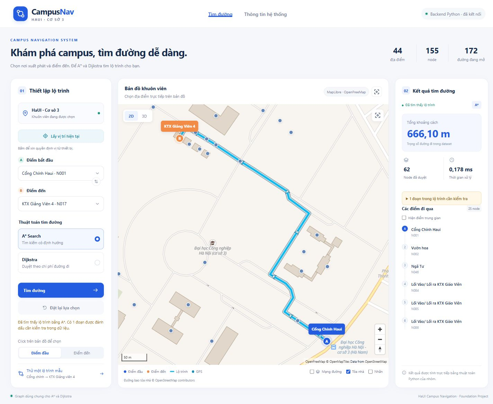
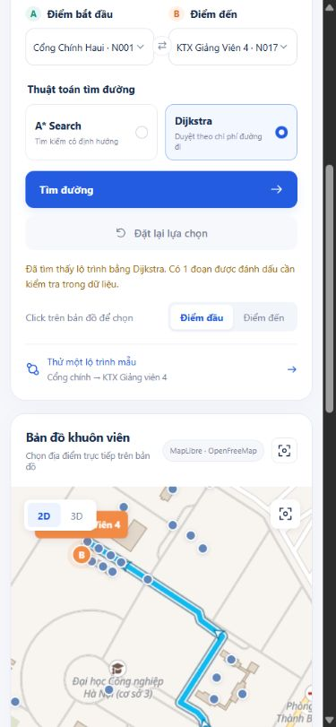

# CHƯƠNG 3. KẾT QUẢ

Chương này trình bày cách cài đặt, chạy thử và đánh giá hệ thống CampusNav hỗ trợ tìm đường tại cơ sở 3 của Trường Đại học Công nghiệp Hà Nội. Nội dung được xây dựng từ phiên bản mã nguồn và dữ liệu đang có trong dự án, kết hợp kết quả thực nghiệm ngày 29/10/2026. Các kết quả thuật toán, kiểm thử tự động và kiểm tra giao diện được ghi nhận riêng để làm rõ phạm vi đã xác minh của sản phẩm.

## 3.1. Cài đặt chương trình

Hệ thống gồm giao diện website sử dụng HTML, CSS và JavaScript, máy chủ Python cung cấp API và các mô-đun tính toán A*, Dijkstra. Website và API được phục vụ trên cùng một địa chỉ. Hai thuật toán sử dụng chung bộ dữ liệu nút và cạnh, do đó người dùng có thể thay đổi thuật toán trên giao diện để đối chiếu kết quả trong cùng điều kiện dữ liệu.

### 3.1.1. Phần mềm yêu cầu

Máy tính cần có Python từ phiên bản 3.10 trở lên để chạy máy chủ và thuật toán. Backend sử dụng các thư viện chuẩn của Python như http.server, json, csv và heapq; phiên bản hiện tại không yêu cầu cài Flask hoặc FastAPI. Máy chủ HTTP phù hợp với phạm vi chạy thử cục bộ của đồ án; việc triển khai cho nhiều người dùng cần được thiết kế và đánh giá bổ sung [3].

Bảng 3.1. Phần mềm và điều kiện chạy chương trình

| Thành phần | Yêu cầu hoặc vai trò |
|---|---|
| Python | Phiên bản 3.10 trở lên; môi trường đo sử dụng Python 3.12.14 |
| Trình duyệt | Có hỗ trợ JavaScript; WebGL phục vụ bản đồ MapLibre; cần kiểm tra tương thích trên thiết bị cụ thể |
| Git | Chỉ cần khi tải mã nguồn từ kho Git; không bắt buộc với bản ZIP |
| Node.js | Chỉ cần khi chạy bộ kiểm thử JavaScript; không phải điều kiện để backend Python phục vụ website |
| Kết nối Internet | Phục vụ bản đồ nền trực tuyến; dự án có dữ liệu khuôn viên cục bộ làm phương án dự phòng |
| Điều kiện định vị | Trình duyệt hỗ trợ Geolocation, người dùng cho phép truy cập vị trí và ngữ cảnh an toàn |

Để kiểm tra Python, mở PowerShell và thực hiện lệnh sau. Kết quả phải hiển thị phiên bản từ 3.10 trở lên; nếu máy không có trình khởi chạy py thì dùng python --version.

```powershell
py -3 --version
```

Đối với định vị, trình duyệt yêu cầu ngữ cảnh an toàn và quyền truy cập của người dùng [6]. Trong môi trường phát triển trên chính máy đang chạy trình duyệt có thể sử dụng localhost hoặc 127.0.0.1. Khi triển khai để điện thoại truy cập máy chủ từ xa, cần cấu hình HTTPS; việc dùng địa chỉ IP của máy tính qua HTTP không tương đương localhost của điện thoại.

### 3.1.2. Clone project

Mã nguồn được quản lý tại kho GitHub của nhóm. Người triển khai cần tải đầy đủ kho mã nguồn để giữ nguyên quan hệ giữa website, backend, dữ liệu và các thư viện bản đồ. Từ một thư mục làm việc phù hợp, thực hiện các lệnh sau để clone và chuyển vào thư mục dự án.

```powershell
$repoOwner = 'https://github.com/Daiijin/'
$repoName = 'Shortest-Path-Finding-in-a-Campus-Navigation-System.git'
git clone ($repoOwner + $repoName)
Set-Location -LiteralPath '.\Shortest-Path-Finding-in-a-Campus-Navigation-System'
```

Phiên bản được kiểm tra trong báo cáo là kho mã nguồn đang lưu tại D:\Study\Foundation prj\Shortest-Path-Finding-in-a-Campus-Navigation-System. Sau khi đã tải mã nguồn, có thể chuyển trực tiếp vào thư mục này trên máy thực nghiệm. Người sử dụng máy khác cần thay đường dẫn cục bộ theo vị trí đã clone.

```powershell
Set-Location -LiteralPath 'D:\Study\Foundation prj'
Set-Location -LiteralPath `
  '.\Shortest-Path-Finding-in-a-Campus-Navigation-System'
```

Bảng 3.2. Các thành phần chính cần giữ trong thư mục dự án

| Tệp hoặc thư mục | Vai trò |
|---|---|
| index.html và css | Cấu trúc trang và định dạng giao diện |
| js | Xử lý tương tác, bản đồ, API và vị trí |
| vendor | Các thư viện bản đồ được lưu cùng dự án |
| data/campus3 | JSON đồ thị và dữ liệu GeoJSON khuôn viên |
| haui_astar_project | Thuật toán Python, dịch vụ tìm đường và hai CSV nguồn |
| web_server.py | Phục vụ website và các API |
| run_website.cmd | Hỗ trợ khởi động trên Windows |
| sync_graph_data.py | Kiểm tra và đồng bộ dữ liệu đồ thị |

Website tích hợp hiện tại gọi thuật toán Python qua API. Các tệp thuật toán JavaScript trong thư mục js được dùng cho kiểm thử hoặc chạy riêng; chúng không thay thế backend của luồng tìm đường trên website chính.

### 3.1.3. Cấu hình bản đồ

Cấu hình mặc định của dự án là MapLibre kết hợp OpenFreeMap. MapLibre đảm nhiệm hiển thị và tương tác với bản đồ, còn OpenFreeMap cung cấp kiểu bản đồ nền trực tuyến [4], [5]. Để chọn rõ cấu hình này khi chạy, đặt biến môi trường MAP_PROVIDER trong cùng cửa sổ PowerShell trước khi khởi động máy chủ.

```powershell
$env:MAP_PROVIDER = 'openfreemap'
```

Máy chủ cũng có thể đọc cấu hình từ maps_config.local.json. Biến môi trường được ưu tiên hơn tệp cấu hình cục bộ. Tệp maps_config.example.json được cung cấp làm mẫu. Với cấu hình openfreemap, luồng bản đồ mặc định của dự án không cần nhập Google Maps API key. Những cấu hình sử dụng Google Maps chỉ phục vụ phương án tùy chọn và được hướng dẫn riêng trong tài liệu dự án.

Dữ liệu đường bao tòa nhà được lưu tại data/campus3/buildings.geojson, gồm 23 đối tượng tòa nhà; dữ liệu nền khuôn viên được lưu tại data/campus3/basemap.geojson. Bản đồ có các lớp địa điểm, tuyến đường, mạng đường và tòa nhà. Chế độ 3D hiển thị khối tòa nhà theo dữ liệu có sẵn; khi dữ liệu cục bộ thiếu chiều cao, chương trình sử dụng chiều cao minh họa. Vì vậy, chế độ này hỗ trợ quan sát không gian và chưa được xem là mô hình kiến trúc đo đạc chính xác.

Khi nền trực tuyến không tải được, chương trình có cơ chế chuyển sang dữ liệu khuôn viên cục bộ; trường hợp không sử dụng được WebGL có phương án hiển thị dự phòng. Khả năng tìm đường vẫn dựa trên đồ thị CSV của nhóm. Cơ chế dự phòng bản đồ không đồng nghĩa với việc mọi dịch vụ, mọi dữ liệu nền và chức năng định vị đều hoạt động hoàn toàn khi thiết bị mất mạng. Các thành phần bản đồ sử dụng dữ liệu OpenStreetMap cần giữ thông tin ghi công theo giấy phép của nguồn dữ liệu [7].

### 3.1.4. Chạy server

Trên Windows, người dùng có thể nhấp đúp run_website.cmd để chạy chương trình. Tệp này chuyển về thư mục dự án, tìm Python phù hợp và khởi động máy chủ với tùy chọn mở trình duyệt. Ngoài ra, có thể chạy trực tiếp bằng PowerShell sau khi đã chuyển đến thư mục chứa mã nguồn.

```powershell
py -3 web_server.py
```

Máy chủ mặc định lắng nghe tại 127.0.0.1, cổng 8765. Khi khởi động thành công, terminal hiển thị địa chỉ truy cập, hai thuật toán được tích hợp và thống kê đồ thị. Với dữ liệu sử dụng trong chương này, thông tin tương ứng là 155 nút và 172 cạnh đang mở. Nếu cổng 8765 đã được sử dụng, chọn cổng khác bằng tham số --port.

```powershell
py -3 web_server.py --port 8766
```

Cần giữ cửa sổ terminal hoạt động trong thời gian sử dụng website. Dừng máy chủ bằng tổ hợp Ctrl+C. Phiên bản tích hợp cần được chạy qua web_server.py; mở trực tiếp index.html hoặc chỉ dùng Live Server không cung cấp API Python nên không hoàn thành luồng tìm đường của hệ thống.

Nếu thay đổi CSV, chạy công cụ đồng bộ và kiểm tra dữ liệu trước khi khởi động lại máy chủ. Backend nạp đồ thị khi được khởi tạo, nên thay tệp dữ liệu mà không nạp lại chương trình có thể khiến phiên chạy tiếp tục sử dụng đồ thị cũ.

```powershell
py -3 sync_graph_data.py
py -3 sync_graph_data.py --check
```

### 3.1.5. Truy cập ứng dụng

Sau khi máy chủ hoạt động, mở trình duyệt và truy cập http://127.0.0.1:8765. Nếu đã đổi cổng, cần sử dụng cổng tương ứng trong URL. Có thể kiểm tra riêng tình trạng backend qua địa chỉ /api/health. API này cung cấp trạng thái hoạt động, danh sách thuật toán và số lượng nút, cạnh đang sử dụng.

Trên giao diện, người dùng tìm địa điểm bằng tên, từ khóa không dấu hoặc mã nút rồi chọn điểm bắt đầu và điểm đến. Có thể chọn địa điểm bằng marker trên bản đồ với chế độ Điểm đầu hoặc Điểm đến. Sau đó, người dùng chọn A* hoặc Dijkstra và bấm Tìm đường. Nút lộ trình mẫu hỗ trợ kiểm tra nhanh tuyến Cổng chính đến KTX Giảng viên 4.

Kết quả gồm tuyến được vẽ trên bản đồ, tổng khoảng cách, số nút đã duyệt, thời gian xử lý và danh sách các điểm đi qua. Tùy chọn Hiện điểm trung gian chỉ thay đổi danh sách kết quả; tuyến bản đồ vẫn giữ đầy đủ các nút trung gian. Khoảng cách hiển thị theo mét, thời gian hiển thị theo mili giây. Thời gian nhận từ backend được tính bằng giây và được giao diện chuyển đổi trước khi trình bày.

Nút đổi hai điểm giúp đảo điểm đầu và điểm đến; nút Đặt lại lựa chọn xóa lựa chọn và kết quả, đưa thuật toán về A*. Khi dùng Lấy vị trí hiện tại, trình duyệt xin quyền truy cập vị trí. Nếu dữ liệu vị trí đáp ứng điều kiện, chương trình gợi ý một địa điểm gần nhất để người dùng xác nhận làm điểm đầu. Tuyến hiện tại bắt đầu từ địa điểm đó, chưa tính đoạn từ tọa độ GPS đến mạng đường.

## 3.2. Kết quả thực nghiệm

Thực nghiệm được thực hiện trên Windows 11, Python 3.12.14, với bộ CSV nguồn hiện có tại thời điểm 29/10/2026. Mã nguồn, dữ liệu đồ thị và cấu hình thuật toán được giữ thống nhất trong quá trình so sánh. Kiểm tra giao diện được thực hiện qua trình duyệt tích hợp và máy chủ localhost; các khung hình nhỏ được dùng để kiểm tra responsive, không thay thế thử nghiệm trên thiết bị vật lý.

Bộ dữ liệu đã cập nhật được nhận diện bằng mã SHA-256 rút gọn: nodes_project.csv là c98a5420e65a và edges_project.csv là 4dc959c399e6. Các mã này phân biệt dữ liệu dùng trong lần kiểm tra hiện tại với bộ 87 nút của phiên bản báo cáo trước. Khi tái hiện kết quả, cần dùng đúng hai tệp CSV và đồng bộ JSON tương ứng.

Bảng 3.3. Đặc điểm bộ dữ liệu thực nghiệm

| Thuộc tính | Giá trị |
|---|---|
| Tổng số nút | 155 |
| Nút địa điểm có thể chọn | 44 |
| Nút trung gian | 111 |
| Nút được đánh dấu là điểm rẽ | 77 |
| Tổng số cạnh nguồn | 172 |
| Cạnh đang mở dùng để tìm đường | 172 |
| Cạnh bị khóa | 0 |
| Cạnh đang mở cần kiểm tra | 29 |
| Kiểu đồ thị và trọng số | Vô hướng; khoảng cách tính bằng mét |

### 3.2.1. Kết quả tìm đường giữa các địa điểm

Hệ thống đã tìm được tuyến giữa các địa điểm được lựa chọn trong bộ dữ liệu hiện tại. Bộ kiểm thử thuật toán đối chiếu toàn bộ 44 × 44 = 1.936 cặp điểm đầu và điểm đến, bao gồm 44 trường hợp trùng điểm. Hai thuật toán cho khoảng cách tương đương trong sai số kiểm thử. Kết quả này xác nhận sự phù hợp của hai cách tính trên đồ thị đang sử dụng; độ đúng của đồ thị so với thực địa cần được khảo sát riêng.

Bảng 3.4. Kết quả của 10 tuyến thực nghiệm đại diện

| Mã tuyến | Điểm đầu | Điểm đến | Khoảng cách (m) | Nút tuyến |
|---|---|---|---|---|
| T01 | Cổng Chính Haui (N001) | Kí Túc Quốc Phòng (N007) | 508,00 | 13 |
| T02 | Cổng Chính Haui (N001) | KTX Giảng Viên 4 (N017) | 666,10 | 25 |
| T03 | Cổng Chính Haui (N001) | KTX Giảng Viên 1 (N020) | 599,20 | 18 |
| T04 | Thư Viện C18 (N027) | KTX Giảng Viên 4 (N017) | 933,40 | 32 |
| T05 | Cổng Phụ 1 (N033) | KTX Giảng Viên 1 (N020) | 725,00 | 19 |
| T06 | cổng phụ 2 (N045) | Kí Túc Quốc Phòng (N007) | 702,90 | 18 |
| T07 | Tòa C1 (N022) | Thư Viện C18 (N027) | 844,00 | 17 |
| T08 | C16 (N026) | Cổng Chính Haui (N001) | 866,80 | 14 |
| T09 | Trang Thiết Bị Quốc Phòng Haui (N009) | C15 (N024) | 833,70 | 12 |
| T10 | Căng tin (N083) | Tòa C3 (N023) | 562,00 | 15 |

Tuyến mẫu N001 → N017 tương ứng Cổng chính HaUI → KTX Giảng viên 4 có khoảng cách 666,10 m, gồm 25 nút và 24 đoạn nối. Trình tự các nút được backend trả về như sau; các nút trung gian được giữ lại để đường vẽ bám theo kết nối trong dữ liệu.

N001 → N150 → N002 → N143 → N144 → N139 → N135 →

N131 → N132 → N133 → N124 → N121 → N113 → N102 →

N046 → N084 → N064 → N065 → N085 → N059 → N060 →

N054 → N086 → N050 → N017

Tuyến mẫu đi qua các điểm trung gian mới của dữ liệu đã cập nhật và chứa cạnh E024, dài 25,60 m, được gắn ghi chú “Đoạn nối ngoài đường”. Giao diện hiển thị cảnh báo để người dùng nhận biết đoạn cần kiểm tra. Cạnh này vẫn có enabled=true, nên thuật toán có thể sử dụng trong tìm đường. Cảnh báo không xác nhận đoạn đường đã được khảo sát đầy đủ ngoài thực địa. Bộ dữ liệu hiện tại có 172 cạnh đang mở và không có cạnh bị khóa; khả năng loại cạnh khóa được kiểm tra bằng dữ liệu mô phỏng riêng.



Giao diện thể hiện cùng lúc tuyến đường và thông số do backend trả về. Số 25 nút trên tuyến khác với số nút đã duyệt: nút trên tuyến thuộc kết quả cuối cùng, còn nút đã duyệt phản ánh phạm vi tìm kiếm. Thời gian trên ảnh là một lần chạy qua giao diện, có thể khác thời gian trung bình trong Bảng 3.6.

### 3.2.2. So sánh A* và Dijkstra

Dijkstra sử dụng chi phí từ điểm xuất phát để lựa chọn nút tiếp theo; A* sử dụng thêm thông tin heuristic để hướng tìm kiếm về đích [1], [2]. Trong phiên bản thực nghiệm, cả hai thuật toán dùng chung đồ thị, trọng số và cấu trúc kết quả. Việc so sánh tập trung vào ba yếu tố: khoảng cách tuyến, số nút đã duyệt và thời gian thực hiện thuật toán.

Với mỗi cặp điểm trong Bảng 3.4, mỗi thuật toán được chạy khởi động 30 lần trước khi ghi nhận 500 lần đo. Thứ tự chạy A* và Dijkstra được đảo xen kẽ qua các lượt để giảm ảnh hưởng của việc luôn chạy một thuật toán trước. Thời gian được lấy từ bộ đo perf_counter trong backend, sau đó tính trung bình. Phép đo không bao gồm thời gian tải bản đồ, truyền HTTP, thao tác người dùng hoặc thời gian dựng giao diện. Số liệu là kết quả trên môi trường chạy hiện tại, không phải cam kết thời gian đáp ứng trên mọi máy.

Bảng 3.5. So sánh số nút đã duyệt

| Tuyến | Dijkstra (nút) | A* (nút) | Giảm số nút (%) |
|---|---|---|---|
| N001 → N007 | 79 | 30 | 62,03 |
| N001 → N017 | 128 | 62 | 51,56 |
| N001 → N020 | 103 | 49 | 52,43 |
| N027 → N017 | 137 | 86 | 37,23 |
| N033 → N020 | 112 | 64 | 42,86 |
| N045 → N007 | 117 | 49 | 58,12 |
| N022 → N027 | 141 | 60 | 57,45 |
| N026 → N001 | 127 | 47 | 62,99 |
| N009 → N024 | 140 | 54 | 61,43 |
| N083 → N023 | 110 | 41 | 62,73 |

Tỷ lệ giảm số nút được tính theo công thức: R = (V_D − V_A) / V_D × 100%, trong đó V_D là số nút Dijkstra đã duyệt và V_A là số nút A* đã duyệt. Trung bình cộng tỷ lệ giảm của 10 tuyến là 54,88%. Đây là trung bình các tỷ lệ theo từng tuyến, không phải tỷ lệ được suy ra từ tổng số nút của toàn bộ tuyến.

Bảng 3.6. Thời gian trung bình của 500 lần chạy trên mỗi tuyến

| Tuyến | Dijkstra (ms) | A* (ms) | Nhanh hơn trong lần đo |
|---|---|---|---|
| N001 → N007 | 0,05126 | 0,03861 | A* |
| N001 → N017 | 0,06594 | 0,06176 | A* |
| N001 → N020 | 0,05440 | 0,04979 | A* |
| N027 → N017 | 0,08945 | 0,10341 | Dijkstra |
| N033 → N020 | 0,05880 | 0,06681 | Dijkstra |
| N045 → N007 | 0,06120 | 0,05115 | A* |
| N022 → N027 | 0,07501 | 0,06597 | A* |
| N026 → N001 | 0,07239 | 0,05562 | A* |
| N009 → N024 | 0,06842 | 0,05247 | A* |
| N083 → N023 | 0,07639 | 0,05847 | A* |

Trong 10 tuyến đo, A* có thời gian trung bình thấp hơn ở 8 tuyến; Dijkstra có thời gian trung bình thấp hơn ở 2 tuyến. Trung bình cộng thời gian của 10 tuyến là 0,06040 ms với A* và 0,06732 ms với Dijkstra. Chênh lệch ở mức rất nhỏ và có thể thay đổi theo tải của máy, nên không dùng một lần đo để kết luận tuyệt đối về hiệu năng.

Trên 10 cặp đại diện ở lần thực nghiệm này, hai thuật toán trả về cùng khoảng cách và cùng chuỗi nút. Tuy nhiên, khi xét đủ 1.936 cặp địa điểm, có 86 cặp có cùng chi phí tối ưu nhưng khác chuỗi nút do tồn tại nhiều đường đi đồng hạng. Vì vậy, tiêu chí đối chiếu là chi phí và tính hợp lệ của tuyến, không bắt buộc hai thuật toán luôn trả về một chuỗi nút giống nhau. A* giảm số nút đã duyệt trên cả 10 tuyến, nhưng không luôn có thời gian thấp hơn. Nguyên nhân có thể liên quan đến chi phí tính heuristic và quản lý hàng đợi trong khi đồ thị có 155 nút. Kết quả cho thấy cần đánh giá đồng thời phạm vi tìm kiếm và thời gian thay vì đồng nhất hai chỉ số. Khi mở rộng hoặc sửa dữ liệu, cần đối chiếu lại A* với Dijkstra và kiểm tra sự phù hợp của heuristic.

## 3.3. Bảng kiểm thử hệ thống

Kiểm thử được tổ chức ở mức dữ liệu, thuật toán, API, các hàm xử lý vị trí và một số thao tác giao diện. Lần chạy ngày 29/10/2026 có 4 kiểm thử Python về dữ liệu, 15 kiểm thử Python về API và 12 kiểm thử JavaScript, tổng cộng 31 kiểm thử tự động thành công. Một kiểm thử có thể chứa nhiều tình huống con, ví dụ vòng lặp 1.936 cặp địa điểm; vì vậy, số tình huống trong các bảng dưới đây không được cộng trực tiếp thành số hàm kiểm thử.

Quy ước ghi nhận gồm: “Đạt” khi có kết quả thực thi tương ứng; “Đạt mô phỏng” khi sử dụng dữ liệu hoặc đối tượng giả lập; “Chưa xác minh” khi cần thiết bị, điều kiện mạng hoặc khảo sát bổ sung. Đối với các mục chưa xác minh, bảng trình bày tiêu chí nghiệm thu để tiếp tục đánh giá mà không coi đó là kết quả đã đạt.

### 3.3.1. Kiểm thử chức năng

Bộ kiểm thử API khởi tạo một máy chủ localhost riêng và gửi yêu cầu HTTP tới các API của chương trình. Bộ kiểm thử đồ thị kiểm tra dữ liệu nguồn, dữ liệu JSON và kết quả thuật toán. Ngoài ra, một số thao tác được kiểm tra trực tiếp trên trình duyệt để xác nhận các trạng thái quan sát được trên giao diện.

Bảng 3.7. Kiểm thử dữ liệu và chức năng tìm đường

| Mã | Tình huống và kết quả mong đợi | Kết quả ghi nhận |
|---|---|---|
| CN01 | Nạp đồ thị đúng 155 nút, 172 cạnh mở trong 172 cạnh nguồn | Đạt bằng kiểm thử dữ liệu và API |
| CN02 | Tìm N001 → N017 bằng A*: 666,10 m, 62 nút duyệt, 25 nút tuyến | Đạt ở backend, API và giao diện |
| CN03 | Tìm N001 → N017 bằng Dijkstra: 666,10 m, 128 nút duyệt | Đạt ở backend, API và giao diện |
| CN04 | Đối chiếu khoảng cách hai thuật toán trên 1.936 cặp địa điểm | Đạt trên dữ liệu hiện tại |
| CN05 | Chọn cùng điểm N001: tuyến một nút, khoảng cách 0 | Đạt bằng API và giao diện |
| CN06 | Không chọn điểm đầu: yêu cầu bổ sung trước khi tìm đường | Đạt trên giao diện; API từ chối đầu vào thiếu |
| CN07 | Gửi mã không tồn tại, waypoint hoặc thuật toán sai | Đạt; API trả HTTP 400 |
| CN08 | Không có đường nối: trả found=false, tuyến rỗng, giữ chỉ số tìm kiếm | Đạt mô phỏng đồ thị rời rạc; API trả HTTP 200 |
| CN09 | Fixture mô phỏng có cạnh khóa và đường vòng; thuật toán không sử dụng cạnh khóa | Đạt mô phỏng ở kiểm thử Python và JavaScript |
| CN10 | Giữ nút trung gian và tọa độ tương ứng trong tuyến API | Đạt; dữ liệu tuyến và tọa độ khớp nhau |
| CN11 | Giữ metadata cần kiểm tra; tuyến mẫu cảnh báo cạnh E024 | Đạt bằng API và quan sát giao diện |
| CN12 | CSV và JSON thống nhất mã, trạng thái và thuộc tính | Đạt bằng kiểm thử dữ liệu |
| CN13 | Đầu vào JSON lỗi hoặc Content-Type không phù hợp | Đạt; API trả 400 hoặc 415 theo tình huống |
| CN14 | Tài nguyên website hợp lệ được phục vụ; tệp riêng ngoài danh sách không được phục vụ | Đạt bằng kiểm thử HTTP |

Tình huống không có đường sử dụng đồ thị rời rạc được mô phỏng trong bộ kiểm thử. Tương tự, phép thử đường bị khóa sử dụng một fixture riêng vì dữ liệu hiện tại không có cạnh nào mang trạng thái khóa. Đồ thị các cạnh đang mở của dữ liệu hiện tại vẫn liên thông, vì vậy không sử dụng một cặp địa điểm thực tế bất kỳ để tuyên bố đã xuất hiện trạng thái mất kết nối trên dữ liệu này.

Bảng 3.8. Các thao tác đã kiểm tra trực tiếp trên giao diện

| Mã | Thao tác | Kết quả ghi nhận |
|---|---|---|
| GD01 | Bấm lộ trình mẫu | Hiển thị N001 → N017, tuyến bản đồ và kết quả phù hợp |
| GD02 | Chuyển từ A* sang Dijkstra rồi tìm lại | Thuật toán kết quả đổi sang Dijkstra; khoảng cách giữ 666,10 m |
| GD03 | Bấm Đặt lại lựa chọn | Xóa hai điểm và kết quả; A* được chọn lại |
| GD04 | Bấm Tìm đường khi chưa có điểm đầu | Hiển thị yêu cầu chọn điểm bắt đầu |
| GD05 | Nhập “cong chinh” ở ô tìm điểm đầu | Danh sách tìm được Cổng Chính Haui, mã N001 |
| GD06 | Chọn N001 làm cả điểm đầu và điểm đến | Hiển thị 0,00 m và thông báo đã ở điểm đến |

Các chức năng khác như chuyển nền trực tuyến sang nền cục bộ, thao tác bản đồ 3D, hủy yêu cầu khi thay đổi dữ liệu và mọi trường hợp mất kết nối chưa được kiểm thử toàn diện bằng trình duyệt trong đợt xác minh này. Chúng cần bổ sung kịch bản tương ứng trước khi khẳng định mức độ ổn định của toàn bộ giao diện.

### 3.3.2. Kiểm thử định vị GPS

Chức năng thường được gọi là GPS trong giao diện sử dụng Browser Geolocation. Nguồn vị trí thực tế do thiết bị và trình duyệt xác định, nên không thể mặc nhiên xem mọi tọa độ trả về là số đo GPS vệ tinh. Chương trình lấy vị trí một lần theo thao tác người dùng, yêu cầu ưu tiên độ chính xác cao, đặt thời gian chờ 15 giây và không sử dụng vị trí lưu đệm trong lời gọi này.

Sau khi nhận tọa độ, chương trình kiểm tra tính hợp lệ và tìm nút loại location gần nhất. Điều kiện mặc định để gợi ý là khoảng cách đến địa điểm gần nhất không vượt 100 m và bán kính sai số không vượt 100 m. Đây là ngưỡng của chương trình để hạn chế gợi ý không phù hợp, chưa phải ranh giới địa lý chính xác của khuôn viên. Một vị trí bị từ chối do vượt khoảng cách chỉ có nghĩa là chưa có địa điểm đủ gần theo ngưỡng này.

Bảng 3.9. Kiểm thử logic định vị bằng dữ liệu mô phỏng

| Mã | Tình huống và kết quả mong đợi | Kết quả ghi nhận |
|---|---|---|
| GPS01 | Trả tọa độ hợp lệ cùng bán kính sai số | Đạt mô phỏng; dữ liệu được chuẩn hóa |
| GPS02 | Địa điểm A cách khoảng 55,6 m; waypoint gần hơn không được chọn | Đạt mô phỏng; chỉ gợi ý location A |
| GPS03 | Không có location trong khoảng cho phép | Đạt mô phỏng; không cho xác nhận điểm đầu |
| GPS04 | Sai số vị trí 250 m vượt ngưỡng 100 m | Đạt mô phỏng; từ chối gợi ý |
| GPS05 | Danh sách địa điểm rỗng | Đạt mô phỏng; trả trạng thái không có địa điểm |
| GPS06 | Tọa độ NaN, vĩ độ ngoài giới hạn hoặc sai số âm | Đạt mô phỏng; từ chối dữ liệu |
| GPS07 | Người dùng từ chối quyền truy cập vị trí | Đạt mô phỏng; thông báo hướng dẫn về quyền vị trí |
| GPS08 | Thiết bị không xác định được vị trí hoặc hết thời gian chờ | Đạt mô phỏng; có thông báo lỗi tương ứng |
| GPS09 | Ngữ cảnh không an toàn hoặc trình duyệt không hỗ trợ | Đạt mô phỏng; từ chối trước khi lấy vị trí |
| GPS10 | Kiểm tra tham số yêu cầu định vị một lần | Đạt mô phỏng; ưu tiên độ chính xác, timeout 15 giây, maximumAge=0 |

Các kiểm thử trên xác minh logic xử lý thông qua đối tượng Geolocation mô phỏng, không chứng minh độ chính xác định vị ngoài thực địa. Đợt kiểm tra này chưa thu vị trí thật của người dùng và chưa đo sai số bằng thiết bị vật lý trong khuôn viên.

Bảng 3.10. Các trường hợp cần thử nghiệm định vị ngoài thực địa

| Tình huống | Tiêu chí đánh giá tiếp theo | Trạng thái |
|---|---|---|
| Điện thoại đứng tại địa điểm đã biết trong khuôn viên | Đối chiếu vị trí, bán kính sai số và địa điểm gợi ý với vị trí tham chiếu | Chưa xác minh |
| Thiết bị ở gần nhiều địa điểm | Kiểm tra gợi ý và thao tác xác nhận điểm đầu có phù hợp thực tế | Chưa xác minh |
| Tín hiệu yếu, khu vực trong nhà hoặc gần tòa nhà | Ghi nhận tỷ lệ lấy được vị trí, thời gian và độ sai lệch | Chưa xác minh |
| Từ chối quyền trên trình duyệt điện thoại thật | Kiểm tra nội dung thông báo và khả năng thử lại | Chưa xác minh |
| Truy cập bản triển khai HTTPS từ điện thoại | Kiểm tra quyền vị trí và kết nối backend trong môi trường triển khai | Chưa xác minh |

Phiên bản hiện tại chưa theo dõi vị trí liên tục, chưa cảnh báo lệch tuyến và chưa tính đoạn kết nối từ tọa độ người dùng tới nút xuất phát. Các đặc điểm này được ghi nhận là giới hạn chức năng, không trình bày như các ca kiểm thử đã đạt.

### 3.3.3. Kiểm thử giao diện trên các thiết bị

Giao diện được kiểm tra trong cùng trình duyệt với ba kích thước khung hình đại diện: 1440 × 1000, 768 × 1024 và 390 × 844 pixel CSS. Đây là phép thử bố cục theo kích thước, không phải xác nhận tương thích trên ba loại thiết bị vật lý. Với màn hình lớn, vùng thao tác, bản đồ và kết quả nằm thành ba cột; ở hai khung hình nhỏ hơn, các phần chuyển sang bố cục một cột để cuộn theo chiều dọc.

Bảng 3.11. Kết quả kiểm tra responsive trên trình duyệt

| Khung hình | Bố cục quan sát | Kiểm tra chiều ngang | Kết quả chức năng |
|---|---|---|---|
| Máy tính 1440 × 1000 | Ba cột: thiết lập, bản đồ, kết quả | scrollWidth=clientWidth=1425 px; không tràn trang ngang | Tuyến mẫu và chuyển thuật toán hoạt động |
| Máy tính bảng 768 × 1024 | Một cột; các vùng xếp theo chiều dọc | scrollWidth=clientWidth=753 px; không tràn trang ngang | Kết quả Dijkstra giữ đúng khi đổi kích thước |
| Điện thoại 390 × 844 | Một cột; cần cuộn để xem bản đồ và kết quả | scrollWidth=clientWidth=375 px; không tràn trang ngang | Đã thử tuyến mẫu, đặt lại, tìm không dấu, trùng điểm |

Các giá trị clientWidth nhỏ hơn chiều rộng khung hình do phần diện tích dành cho thanh cuộn. Kết quả không tràn ngang được xác định bằng việc scrollWidth bằng clientWidth tại trạng thái quan sát, không suy ra chỉ từ quy tắc CSS. Trên khung hình điện thoại, trang dài hơn chiều cao màn hình nên người dùng cần cuộn dọc; đây là cách tổ chức bố cục hiện tại.



Các ảnh minh họa được lấy từ phiên chạy website thực tế. Hình 3.2 thể hiện một vùng của trang tại vị trí cuộn sau thao tác, không phải toàn bộ nội dung ứng dụng trong một màn hình. Khả năng thao tác bằng cảm ứng, xoay màn hình, bàn phím ảo, hiệu năng WebGL và hành vi trên Safari iOS hoặc Chrome Android cần kiểm tra tiếp bằng thiết bị tương ứng.

Bảng 3.12. Phạm vi kiểm thử giao diện cần bổ sung

| Hạng mục | Tiêu chí cần kiểm tra | Trạng thái |
|---|---|---|
| Điện thoại Android thật | Chọn địa điểm, cuộn, phóng bản đồ và kiểm tra bàn phím ảo | Chưa xác minh |
| iPhone hoặc iPad thật | Tương thích trình duyệt, quyền vị trí, bản đồ và hiển thị tuyến | Chưa xác minh |
| Xoay dọc và ngang | Bản đồ cập nhật kích thước; điều khiển không che kết quả | Chưa xác minh trên thiết bị thật |
| Mạng chậm hoặc gián đoạn | Thông báo trạng thái, khả năng thử lại và bản đồ dự phòng | Chưa xác minh toàn bộ luồng UI |
| Thiết bị hạn chế WebGL | Chuyển phương án hiển thị và giữ khả năng xem tuyến | Chưa xác minh trên thiết bị thật |

Trong phạm vi đã kiểm tra, hệ thống hoàn thành luồng từ lựa chọn địa điểm tới nhận tuyến và hiển thị kết quả ở ba kích thước khung hình. Các kiểm thử tự động xác nhận tính nhất quán của dữ liệu và thuật toán, trong khi kiểm tra giao diện xác nhận một số thao tác chính. Việc mở rộng thử nghiệm thực địa và thiết bị thật là bước tiếp theo để đánh giá khả năng sử dụng thực tế của sản phẩm.


# CHƯƠNG 4. KIẾN THỨC LĨNH HỘI VÀ BÀI HỌC KINH NGHIỆM

Thông qua quá trình xây dựng hệ thống CampusNav hỗ trợ tìm đường trong khuôn viên Trường Đại học Công nghiệp Hà Nội, nhóm đã vận dụng kiến thức về đồ thị, thuật toán tìm đường và lập trình ứng dụng để tạo ra sản phẩm có thể chạy thử trên máy tính. Chương này trình bày những kiến thức, kỹ năng được củng cố, mức độ đáp ứng yêu cầu học tập, các bài học rút ra từ sản phẩm đã thực hiện và định hướng phát triển trong thời gian tiếp theo.

## 4.1. Nội dung đã thực hiện

Sản phẩm hiện tại là website sử dụng HTML, CSS và JavaScript, kết nối với máy chủ Python để thực hiện tìm đường bằng thuật toán A* hoặc Dijkstra. Các thành phần giao diện, API và thuật toán sử dụng chung một mô hình dữ liệu đường đi. Cách tổ chức này giúp duy trì kết quả thống nhất, đồng thời thuận tiện khi kiểm tra và mở rộng chương trình.

Dữ liệu tìm đường được lưu trong các tệp CSV, sau đó chuyển thành đồ thị vô hướng có trọng số khoảng cách tính bằng mét. Bộ dữ liệu hiện tại có 155 nút, gồm 44 nút địa điểm và 111 nút trung gian; 77 nút được đánh dấu là điểm rẽ. Toàn bộ 172 cạnh trong dữ liệu hiện tại đang mở và được sử dụng để tính đường đi. Mô hình vẫn hỗ trợ thuộc tính enabled để loại một cạnh khỏi đồ thị khi cần khóa đường; hành vi này được kiểm tra bằng fixture mô phỏng thay vì gán trạng thái khóa cho một cạnh đang mở trong dữ liệu thực.

Website cho phép tìm kiếm địa điểm, chọn điểm đầu và điểm đến, lựa chọn thuật toán, hiển thị tuyến đường và xem các thông số kết quả. Phần bản đồ sử dụng MapLibre kết hợp OpenFreeMap ở cấu hình mặc định, có chế độ hiển thị 2D và 3D cùng dữ liệu bản đồ khuôn viên lưu cục bộ. Chức năng lấy vị trí hiện tại sử dụng khả năng định vị của trình duyệt để hiển thị vị trí, vòng sai số và gợi ý địa điểm gần nhất khi đáp ứng điều kiện của hệ thống.

### 4.1.1. Kiến thức chuyên môn đã lĩnh hội

Qua việc mô hình hóa khuôn viên trường, nhóm củng cố kiến thức biểu diễn bài toán thực tế bằng đồ thị. Các địa điểm và điểm trung gian được biểu diễn thành đỉnh; các đoạn đường nối giữa chúng được biểu diễn thành cạnh. Trọng số cạnh thể hiện khoảng cách di chuyển trong dữ liệu. Việc phân biệt nút địa điểm với nút trung gian giúp giao diện chỉ cung cấp các địa điểm có ý nghĩa cho người dùng, trong khi thuật toán vẫn đi qua đầy đủ các nút cần thiết để mô tả đường rẽ và hình dạng tuyến đường.

Trong quá trình cài đặt, nhóm làm rõ cách hoạt động của Dijkstra và A*. Dijkstra lựa chọn nút dựa trên chi phí nhỏ nhất đã xác định từ điểm xuất phát. A* kết hợp chi phí đã đi g(n) với giá trị ước lượng tới đích h(n) theo công thức f(n) = g(n) + h(n). Trong dự án, hàm heuristic ước lượng khoảng cách đường thẳng từ tọa độ địa lý sau khi quy đổi chênh lệch tọa độ sang mét ở quy mô khuôn viên. Cả hai thuật toán sử dụng hàng đợi ưu tiên để lựa chọn nút tiếp theo và lưu thông tin truy vết để khôi phục đường đi.

Việc so sánh hai thuật toán giúp nhóm hiểu rằng chất lượng của A* phụ thuộc vào sự phù hợp giữa hàm heuristic và trọng số dữ liệu. Khi cập nhật khoảng cách hoặc mô hình đồ thị, cần kiểm tra lại kết quả với Dijkstra thay vì mặc nhiên cho rằng mọi heuristic đều bảo đảm đường đi tối ưu. Bộ kiểm thử đã đối chiếu khoảng cách của hai thuật toán trên toàn bộ 1.936 cặp địa điểm có thể chọn, bao gồm trường hợp trùng điểm, và cho kết quả phù hợp trong sai số kiểm thử trên bộ dữ liệu hiện tại. Trong đó, 86 cặp có cùng chi phí nhưng khác chuỗi nút kết quả, nên tính tương đương cần được đánh giá theo chi phí và sự hợp lệ của tuyến. Kiểm tra mở rộng trên 24.025 cặp của toàn bộ 155 nút cũng chưa ghi nhận sai khác chi phí. Tuy nhiên, do trọng số khoảng cách được làm tròn, đã quan sát được độ vượt của ước lượng đường thẳng so với một cạnh kề lớn nhất khoảng 0,025315 m. Các kết quả thực nghiệm này chưa phải chứng minh toán học rằng heuristic luôn chấp nhận được hoặc nhất quán; cần đánh giá lại khi thay dữ liệu hoặc cách làm tròn.

Nhóm cũng củng cố kiến thức về kiến trúc ứng dụng web. Trình duyệt đảm nhiệm việc tiếp nhận thao tác, hiển thị bản đồ và trình bày kết quả; máy chủ Python tiếp nhận yêu cầu và gọi thuật toán. Dữ liệu được trao đổi qua HTTP dưới dạng JSON. Trong đó, GET /api/graph cung cấp dữ liệu đồ thị, còn POST /api/route tiếp nhận yêu cầu tìm đường. Việc thống nhất cấu trúc kết quả với các trường đường đi, khoảng cách, số nút đã duyệt và thời gian thực hiện giúp giao diện xử lý được đầu ra của cả hai thuật toán.

Một kiến thức thực tế khác là sự khác nhau giữa bản đồ nền và dữ liệu dùng để tìm đường. Bản đồ nền hỗ trợ người dùng quan sát vị trí, còn tuyến đường được tính trên đồ thị do nhóm xây dựng. Vì vậy, hình ảnh bản đồ rõ ràng chưa đủ để khẳng định tuyến đường đúng với thực địa. Độ tin cậy của kết quả còn phụ thuộc vào tọa độ nút, các kết nối và khoảng cách được nhập vào hệ thống.

### 4.1.2. Kỹ năng đạt được trong quá trình thực hiện đồ án

Quá trình xây dựng sản phẩm giúp nhóm thực hành phân chia chương trình thành các thành phần có nhiệm vụ cụ thể. Thành phần đọc và kiểm tra dữ liệu được tách khỏi thuật toán; thành phần cung cấp dịch vụ tìm đường được tách khỏi giao diện và máy chủ HTTP. Cách tổ chức này giúp xác định rõ vị trí cần điều chỉnh khi thay đổi dữ liệu, bổ sung thông tin kết quả hoặc cập nhật cách hiển thị tuyến đường.

Về xử lý dữ liệu, nhóm thực hành kiểm tra mã nút, tọa độ, tham chiếu của cạnh và trọng số trước khi đưa vào chương trình. Những trường trạng thái như enabled và needsReview được xử lý theo đúng ý nghĩa thay vì chỉ đọc dưới dạng chuỗi. Đặc biệt, giá trị chuỗi "False" cần được chuyển thành giá trị logic tương ứng, tránh làm một cạnh bị khóa trở thành cạnh có thể đi. Công cụ đồng bộ dữ liệu giúp duy trì sự thống nhất giữa CSV nguồn và JSON phục vụ các thành phần JavaScript.

Về giao diện, nhóm thực hành kết nối các thao tác chọn địa điểm, đổi điểm đầu và điểm đến, lựa chọn thuật toán và đặt lại kết quả. Khi thay đổi lựa chọn, chương trình cần xóa kết quả cũ và xử lý yêu cầu đang chờ để tránh hiển thị tuyến đường không còn phù hợp. Các tình huống thiếu dữ liệu, chọn điểm không hợp lệ, hai điểm trùng nhau hoặc không có đường đi cũng cần được thể hiện bằng trạng thái rõ ràng cho người sử dụng.

Về kiểm thử, nhóm có cơ sở thực hành kiểm tra từ mức dữ liệu, thuật toán đến API và các hàm xử lý vị trí. Việc xây dựng các tệp hướng dẫn chạy, cấu hình bản đồ và cập nhật dữ liệu cũng hỗ trợ quá trình bàn giao giữa các thành viên. Các tài liệu này giúp người tiếp nhận có thể tái hiện môi trường chạy và hiểu được nguồn dữ liệu chính của chương trình.

### 4.1.3. Mức độ đáp ứng chuẩn đầu ra của học phần

Xét trên những năng lực thể hiện qua sản phẩm, đồ án cung cấp minh chứng cho khả năng phân tích và mô hình hóa bài toán tìm đường. Nhóm đã xác định được dữ liệu đầu vào, dữ liệu đầu ra, cách biểu diễn mạng đường và các thao tác chính của người dùng. Mô hình đồ thị được hiện thực hóa bằng dữ liệu có cấu trúc và được sử dụng trực tiếp trong chương trình.

Đối với năng lực vận dụng thuật toán và lập trình, sản phẩm đã tích hợp A* và Dijkstra vào một dịch vụ tìm đường dùng chung. Hai thuật toán trả về cấu trúc kết quả thống nhất, hỗ trợ quan sát khoảng cách, số nút đã duyệt và thời gian xử lý. Chẳng hạn, với tuyến N001 đến N017, tương ứng Cổng chính HaUI đến KTX Giảng viên 4, hai thuật toán cùng trả về khoảng cách 666,10 m trên bộ dữ liệu hiện tại. A* duyệt 62 nút, trong khi Dijkstra duyệt 128 nút; tuyến kết quả gồm 25 nút. Đây là minh chứng cho việc sử dụng kết quả chạy chương trình để phân tích hành vi thuật toán trong một trường hợp cụ thể.

Đối với năng lực kiểm tra và đánh giá sản phẩm, lần xác minh phục vụ hoàn thiện báo cáo đã chạy thành công 4 kiểm thử Python về dữ liệu đồ thị, 15 kiểm thử Python về API và 12 kiểm thử JavaScript về đồ thị và xử lý vị trí. Các kiểm thử bao gồm tính thống nhất của dữ liệu, loại bỏ cạnh khóa trong fixture mô phỏng, kết quả tìm đường, đầu vào không hợp lệ và các tình huống lỗi định vị được mô phỏng. Kết quả này phản ánh phạm vi kiểm thử tự động hiện có; độ chính xác GPS tại thực địa và chất lượng trải nghiệm trên từng thiết bị vẫn cần được đánh giá riêng.

Đối với năng lực trình bày và bàn giao, dự án có hướng dẫn chạy website, cấu hình bản đồ, kiểm thử và đồng bộ dữ liệu. Các thành phần này hỗ trợ việc giải thích giải pháp và tái hiện sản phẩm. Việc xác định mã chuẩn đầu ra cụ thể và mức độ hoàn thành chính thức cần được đối chiếu với đề cương học phần và tiêu chí đánh giá của giảng viên; các minh chứng nêu trên là căn cứ kỹ thuật cho việc đối chiếu đó.

### 4.1.4. Bài học kinh nghiệm

Bài học đầu tiên là cần kiểm tra dữ liệu đường đi trước khi đánh giá thuật toán. Thuật toán có thể tìm được đường ngắn nhất trên đồ thị nhưng tuyến đó vẫn chưa phù hợp với thực tế nếu dữ liệu có cạnh nối sai hoặc đoạn đường không thể đi. Dự án hiện còn 29 cạnh đang mở được đánh dấu cần kiểm tra. Trạng thái này chỉ cung cấp thông tin để rà soát, không tự động loại cạnh khỏi quá trình tìm đường. Do đó, cần phân biệt rõ cạnh bị khóa với cạnh đang mở nhưng cần xác minh.

Bài học thứ hai là cần giữ đầy đủ nút trung gian trong tuyến kết quả. Nếu chỉ nối trực tiếp các địa điểm được hiển thị, đường vẽ có thể cắt qua tòa nhà hoặc khu vực không có lối đi. Việc ẩn điểm trung gian khỏi danh sách lựa chọn giúp giao diện dễ sử dụng, nhưng các điểm đó vẫn phải được giữ trong đường đi và tọa độ dùng để vẽ tuyến.

Bài học thứ ba là cần phân biệt các chỉ số khi so sánh thuật toán. Số nút đã duyệt phản ánh phạm vi tìm kiếm, còn thời gian xử lý còn chịu ảnh hưởng của chi phí tính heuristic và môi trường thực thi. Vì vậy, ví dụ A* duyệt ít nút hơn chưa đủ để kết luận A* luôn chạy nhanh hơn. Khi đánh giá thời gian, cần sử dụng cùng bộ dữ liệu, cùng cặp điểm và nhiều lần chạy; dự án đã có chương trình hỗ trợ so sánh theo cách này.

Bài học tiếp theo liên quan đến định vị. Vị trí do trình duyệt cung cấp có sai số và phụ thuộc vào quyền truy cập cùng khả năng của thiết bị. Hệ thống hiện chỉ lấy vị trí theo thao tác của người dùng, hiển thị vòng sai số và gợi ý địa điểm phù hợp để xác nhận làm điểm đầu. Tuyến tìm đường vẫn bắt đầu tại địa điểm được chọn, chưa bao gồm đoạn di chuyển từ tọa độ GPS đến địa điểm đó. Cần trình bày rõ giới hạn này để người dùng hiểu đúng kết quả.

Cuối cùng, việc duy trì dữ liệu dùng chung, kiểm thử tự động và hướng dẫn chạy giúp hạn chế sai lệch khi tích hợp các phần của sản phẩm. Sau mỗi lần cập nhật mạng đường, cần đồng bộ dữ liệu, kiểm tra lại tuyến tiêu biểu và chạy các kiểm thử liên quan. Quá trình này giúp phát hiện ảnh hưởng của thay đổi trước khi sử dụng phiên bản mới để trình bày hoặc đánh giá.

## 4.2. Hướng phát triển

### 4.2.1. Đánh giá tính khả thi và những thuận lợi, khó khăn

Đề tài có tính khả thi trong phạm vi học tập vì bài toán được giới hạn trong khuôn viên trường và có thể biểu diễn bằng một mạng đường quy mô nhỏ. Máy chủ Python sử dụng thư viện chuẩn, dữ liệu được lưu trong CSV và giao diện web có thể chạy trên trình duyệt. Cấu hình bản đồ mặc định không yêu cầu nhóm thiết lập khóa API riêng, giúp thuận tiện khi chạy thử và chia sẻ sản phẩm phục vụ học tập.

Thuận lợi của dự án là các thành phần dữ liệu, thuật toán và giao diện đã được kết nối thành một quy trình hoàn chỉnh. Người dùng có thể thực hiện từ bước chọn địa điểm đến xem tuyến và thông số kết quả. Dữ liệu bản đồ khuôn viên lưu cục bộ cùng cơ chế hiển thị dự phòng cũng tạo điều kiện tiếp tục quan sát dữ liệu khi bản đồ nền trực tuyến không tải được trong các điều kiện được chương trình hỗ trợ.

Khó khăn chủ yếu nằm ở việc bảo đảm dữ liệu phản ánh đúng đường đi thực tế. Một số cạnh còn cần kiểm tra, tọa độ và khoảng cách cần được đối chiếu thêm với thực địa. Đồ thị hiện được mô hình hóa theo dạng vô hướng, chưa phân biệt các tuyến đi một chiều hoặc quy định riêng cho từng phương tiện. Việc cập nhật trạng thái đường vẫn thông qua tệp dữ liệu và cần nạp lại dữ liệu ở máy chủ, chưa có chức năng quản trị trực tuyến.

Ngoài ra, khả năng hiển thị bản đồ 3D phụ thuộc vào thiết bị và hỗ trợ đồ họa của trình duyệt. Các khối tòa nhà dựng từ dữ liệu cục bộ có thể dùng chiều cao minh họa khi thiếu thông tin chiều cao, nên chưa đại diện cho mô hình kiến trúc chính xác. Chức năng GPS chưa theo dõi liên tục và chưa hỗ trợ dẫn đường từng chặng. Các giới hạn này xác định phạm vi hiện tại của sản phẩm và những công việc cần ưu tiên ở giai đoạn tiếp theo.

### 4.2.2. Định hướng hoàn thiện và phát triển ứng dụng

Ưu tiên trước mắt là khảo sát, đối chiếu các cạnh đang được đánh dấu cần kiểm tra và hoàn thiện bộ dữ liệu đường đi. Với mỗi đoạn chưa phù hợp, cần xác minh khả năng di chuyển, cập nhật trạng thái mở hoặc khóa, điều chỉnh khoảng cách và bổ sung điểm trung gian nếu cần. Sau khi cập nhật, cần kiểm tra lại tính liên thông và đối chiếu kết quả A* với Dijkstra trên các cặp điểm để bảo đảm thay đổi dữ liệu không làm sai lệch kết quả.

Hướng tiếp theo là bổ sung các thuộc tính phục vụ nhu cầu di chuyển cụ thể, chẳng hạn loại đường, bậc thang, khả năng tiếp cận bằng xe lăn hoặc quy định đi một chiều. Khi đó, đồ thị cần được mở rộng tương ứng, đồng thời làm rõ tiêu chí tối ưu là khoảng cách, thời gian hay mức độ thuận tiện. Việc mở rộng tiêu chí cũng đòi hỏi đánh giá lại hàm heuristic để phù hợp với ý nghĩa trọng số mới.

Đối với định vị, có thể phát triển chức năng xác định điểm tiếp cận phù hợp trên mạng đường và tính thêm đoạn kết nối từ vị trí người dùng đến mạng đường. Cần kiểm tra độ chính xác, khả năng đi qua thực tế và sự đồng ý của người dùng trước khi bổ sung theo dõi vị trí liên tục hoặc cảnh báo lệch tuyến. Những chức năng này nên được kiểm chứng ngoài thực địa trên nhiều thiết bị để tránh đưa ra chỉ dẫn không phù hợp.

Về quản lý dữ liệu, có thể xây dựng giao diện quản trị để cập nhật địa điểm và trạng thái đoạn đường, thay cho thao tác chỉnh sửa CSV trực tiếp. Các thay đổi cần được kiểm tra hợp lệ và lưu lịch sử để có thể truy nguyên hoặc khôi phục khi phát hiện sai sót. Khi nhu cầu sử dụng tăng, có thể chuyển dữ liệu sang cơ sở dữ liệu phù hợp và triển khai máy chủ trên môi trường có HTTPS để hỗ trợ truy cập từ điện thoại.

Về đánh giá sản phẩm, cần mở rộng kiểm thử giao diện trên máy tính, máy tính bảng và điện thoại, kết hợp thử nghiệm với người dùng thực tế. Đánh giá thuật toán nên được thực hiện trên nhiều tuyến và nhiều lần chạy, ghi nhận cả khoảng cách, số nút duyệt và thời gian trung bình. Các kết quả này sẽ hỗ trợ lựa chọn phương án phù hợp khi mở rộng dữ liệu sang khu vực hoặc cơ sở khác.

### 4.2.3. Đề xuất, kiến nghị với giảng viên

Nhóm đề xuất giảng viên góp ý thêm về cách đánh giá sự phù hợp của hàm heuristic với dữ liệu khoảng cách, phương pháp lựa chọn các tuyến kiểm tra và cách trình bày kết quả so sánh A* với Dijkstra. Những góp ý này giúp phần đánh giá có căn cứ rõ ràng, đồng thời tránh suy rộng kết luận từ một số trường hợp chạy thử.

Nhóm cũng mong nhận được định hướng về tiêu chí khảo sát dữ liệu thực địa, phạm vi chức năng cần ưu tiên và cách đối chiếu minh chứng sản phẩm với chuẩn đầu ra học phần. Nếu có điều kiện, việc tổ chức thử nghiệm trong khuôn viên trường với một nhóm người dùng nhỏ sẽ giúp thu thập phản hồi về tên địa điểm, thao tác tìm kiếm, cách hiển thị tuyến và các đoạn đường cần điều chỉnh. Đây là cơ sở để hoàn thiện CampusNav theo nhu cầu sử dụng thực tế.


# KẾT LUẬN

Đồ án đã xây dựng hệ thống CampusNav hỗ trợ tìm đường giữa các địa điểm trong khuôn viên cơ sở 3 của Trường Đại học Công nghiệp Hà Nội. Sản phẩm tích hợp mô hình đồ thị, hai thuật toán A* và Dijkstra, máy chủ Python và giao diện bản đồ web. Người dùng có thể tìm địa điểm, lựa chọn điểm đầu và điểm đến, xem tuyến cùng các thông số khoảng cách, số nút đã duyệt và thời gian thực hiện thuật toán. Chức năng định vị hỗ trợ gợi ý địa điểm xuất phát khi dữ liệu vị trí đáp ứng điều kiện của chương trình.

Với bộ dữ liệu 155 nút và 172 cạnh đang mở, hai thuật toán cho khoảng cách tương đương trên 1.936 cặp địa điểm trong phạm vi kiểm thử. Thực nghiệm trên 10 tuyến đại diện cho thấy A* giảm số nút đã duyệt trên cả 10 tuyến. Tuy nhiên, thời gian thực hiện còn phụ thuộc chi phí tính toán và môi trường chạy; số nút duyệt ít hơn không đồng nghĩa với việc luôn có thời gian thấp hơn. Những kết quả này giúp làm rõ vai trò của heuristic và cách đánh giá hiệu quả thuật toán trên dữ liệu cụ thể.

Lần kiểm tra phục vụ báo cáo đã chạy thành công 31 kiểm thử tự động và xác minh một số thao tác chính của giao diện. Ba kích thước khung hình được kiểm tra không ghi nhận tràn trang ngang ở trạng thái quan sát. Kết quả định vị được xác minh ở mức logic bằng dữ liệu mô phỏng; sản phẩm vẫn cần kiểm tra thực địa, thiết bị vật lý và các điều kiện mạng khác nhau để đánh giá đầy đủ khả năng sử dụng.

Hạn chế hiện tại tập trung ở độ hoàn thiện dữ liệu đường đi, các cạnh cần kiểm tra, mô hình đồ thị chưa phân biệt chiều di chuyển và chức năng định vị chưa kết nối trực tiếp vị trí người dùng với mạng đường. Trong giai đoạn tiếp theo, nhóm ưu tiên khảo sát dữ liệu, kiểm thử trên thiết bị thật, bổ sung quản lý trạng thái đường và đánh giá lại thuật toán khi mở rộng phạm vi. Quá trình thực hiện đồ án tạo cơ sở để nhóm tiếp tục phát triển kỹ năng mô hình hóa, lập trình, kiểm thử và trình bày giải pháp kỹ thuật.

# TÀI LIỆU THAM KHẢO

[1] P. E. Hart, N. J. Nilsson và B. Raphael, “A Formal Basis for the Heuristic Determination of Minimum Cost Paths,” IEEE Transactions on Systems Science and Cybernetics, tập 4, số 2, tr. 100–107, 1968. DOI: 10.1109/TSSC.1968.300136. https://doi.org/10.1109/TSSC.1968.300136

[2] E. W. Dijkstra, “A note on two problems in connexion with graphs,” Numerische Mathematik, tập 1, tr. 269–271, 1959. DOI: 10.1007/BF01386390. https://doi.org/10.1007/BF01386390

[3] Python Software Foundation, “http.server — HTTP servers,” Python Documentation. https://docs.python.org/3/library/http.server.html. Ngày truy cập: 28/10/2026.

[4] MapLibre, “MapLibre GL JS — Introduction and Documentation.” https://maplibre.org/maplibre-gl-js/docs/. Ngày truy cập: 28/10/2026.

[5] OpenFreeMap, “OpenFreeMap Quick Start Guide.” https://openfreemap.org/quick_start/. Ngày truy cập: 28/10/2026.

[6] W3C, “Geolocation.” https://www.w3.org/TR/geolocation/. Ngày truy cập: 28/10/2026.

[7] OpenStreetMap, “Copyright and License.” https://www.openstreetmap.org/copyright. Ngày truy cập: 28/10/2026.

[8] Nhóm thực hiện đồ án, Bộ mã nguồn và dữ liệu CampusNav cơ sở 3 HaUI, phiên bản cập nhật được kiểm tra ngày 29/10/2026. Kho mã nguồn: https://github.com/Daiijin/Shortest-Path-Finding-in-a-Campus-Navigation-System. SHA-256 dữ liệu rút gọn: nodes_project.csv c98a5420e65a; edges_project.csv 4dc959c399e6. Tài liệu nội bộ gồm README, hướng dẫn website và bản đồ, dữ liệu CSV, các mô-đun thuật toán và bộ kiểm thử của dự án.
